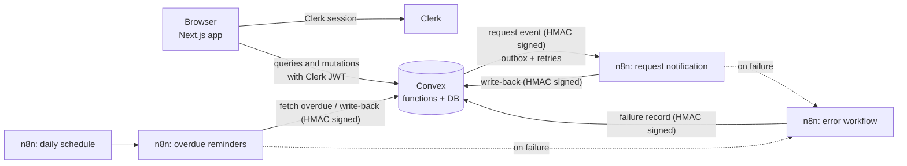

# LendLoop

**Borrow what you need. Lend what you don't.**

LendLoop is a neighborhood tool-lending board. Neighbors list tools they are happy to lend, ask to borrow each other's tools for a date range, and get notifications and overdue reminders from n8n.

- **Stack:** Next.js 16 (App Router) + TypeScript, Clerk for sign-in, Convex for data and backend logic, n8n (Docker) for automations.
- **Public page:** a read-only list of tools that are free right now, name and category only, plus a "Sign in to lend or borrow" button.
- **Signed in:** list, edit and delete your tools (name, category, condition, short description); browse all tools with their availability and a category filter; request a date range; approve or decline requests on your tools; mark a loan returned. Views: All tools, My listings, My requests, Incoming requests.
- **Admin:** remove any listing, see every loan, mark a lender as Trusted Lender, and see failed automation runs.
- **Automations:** a signed webhook from Convex to n8n on every request change, a daily overdue-reminder run, and an error workflow. Each loan shows its recent automation activity, for example "Overdue reminder sent to borrower (1 day late), 2 days ago".

## Architecture



| Piece | Where | What it does |
| --- | --- | --- |
| Next.js app | `app/`, `components/`, `proxy.ts` | Public page, Clerk sign-in pages, the signed-in views. The signed-in layout sends signed-out visitors to sign-in; the real checks live in Convex. |
| Convex functions | `convex/tools.ts`, `requests.ts`, `admin.ts`, `users.ts` | All reads and writes. Every public function checks identity, ownership and role itself. |
| Outbox | `convex/notifications.ts` | Each request change inserts an outbox row and schedules an action that signs and POSTs the event to n8n, retrying with backoff (5 attempts). |
| Signed HTTP endpoints | `convex/http.ts`, `convex/automation.ts` | `/automation/overdue`, `/automation/reminders`, `/automation/notifications`, `/automation/failures`, all HMAC-verified. Write-backs are idempotent. |
| n8n workflows | `n8n/workflows/*.json` | Request notification, overdue reminders, error handler. Exported JSON, no secrets inside. |

### Request lifecycle

```
pending --approve (owner)--> approved --mark returned (owner)--> returned
   |--decline (owner)--> declined
   '--cancel (borrower)--> cancelled
```

Transitions live in one table in `convex/lib/loans.ts`; anything else is rejected. Approving checks that no other approved loan overlaps the dates. An approved loan whose end date has passed is overdue.

### The n8n workflows

1. **LendLoop - request notification** (`request-notification.json`). Webhook `POST /webhook/lendloop-request-events` -> verify the HMAC signature over the raw body -> `401` on a bad, missing or stale signature, otherwise `202` -> build and log the message for the recipient (mock delivery) -> sign and POST a write-back to Convex `/automation/notifications` (3 tries). The write-back is what shows up as "Owner notified of the request" on the loan.
2. **LendLoop - overdue reminders** (`overdue-reminders.json`). Schedule Trigger every day at 08:00 UTC (plus a manual trigger) -> signed `POST /automation/overdue` -> one item per overdue loan -> log a reminder to the borrower (mock delivery) -> signed `POST /automation/reminders` per loan -> summary -> fetch again while Convex says more loans are waiting. Convex leaves loans out of the list once they have today's reminder, and the write-back is keyed `reminder:<loanId>:<day>`, so a retry or a second run the same day records one reminder. Each fetch returns at most 100 loans plus `hasMore`, so the run works through any number of overdue loans in batches; after 20 batches it stops with an error, which the error workflow records.
3. **LendLoop - error handler** (`error-handler.json`). Error Trigger, set as the error workflow of the two above. It records the failure in Convex `/automation/failures` (idempotent per execution id), where admins see it on the Admin page.

**Import by hand instead of `npm run n8n:import`:** in the n8n editor use *Import from file* for the three JSON files, then publish each. The CLI import keeps the fixed workflow ids that link the two workflows to the error handler; if the editor gives new ids, pick "LendLoop - error handler" as the *Error workflow* in each workflow's settings.

**Run the reminder workflow now** instead of waiting for 08:00 UTC (n8n is already running, so the CLI needs a second task-broker port):

```bash
docker exec -e N8N_RUNNERS_BROKER_PORT=5681 lendloop-n8n n8n execute --id=LendLoopOverdue1
```

Mock notifications are `console.log` lines from Code nodes; with `CODE_ENABLE_STDOUT=true` they show in `docker compose logs n8n`, and every run is in the n8n executions list.

## Local setup

Requirements: Node.js 22, npm, Docker (Docker Desktop or Docker Engine with Compose). No Clerk or Convex account is needed for local development.

```bash
npm install

# 1. Temporary Clerk development keys, no account needed (written to .env.local, which is gitignored)
npx clerk@latest init --accountless --framework next --pm npm --no-skills

# 2. Convex: a local deployment with no login (or run `npx convex dev` and choose to run locally
#    without an account). Leave it running in its own terminal.
#    Until step 3 runs it warns that CLERK_JWT_ISSUER_DOMAIN is not set: expected.
CONVEX_AGENT_MODE=anonymous npx convex dev

# 3. In a second terminal: create the Clerk "convex" JWT template and point Convex at Clerk
npm run setup:clerk

# 4. Generate the shared HMAC secrets (n8n/.env) and copy them into the Convex deployment
npm run setup:secrets

# 5. Start n8n and import + publish the three workflows
docker compose up -d
npm run n8n:import

# 6. Start the app on http://localhost:3417 and, optionally, add demo data
npm run dev
npm run seed
```

Already have a Clerk dev instance? Put its `NEXT_PUBLIC_CLERK_PUBLISHABLE_KEY` and `CLERK_SECRET_KEY` in `.env.local` instead of step 1 (see `.env.example`). Prefer a Convex cloud dev deployment? Run plain `npx convex dev` in step 2 and log in.

**Become an admin.** Roles can only be changed from the Convex CLI, never from the app. Sign in once, then:

```bash
npx convex run users:list
npx convex run users:setRole '{"clerkUserId":"user_...","role":"admin"}'
```

**n8n editor.** n8n is published on `127.0.0.1` only, so neither the editor nor its first-run owner setup can be reached from the network. Open http://127.0.0.1:5698 and create the local owner account the first time (it lives only in the container volume). The workflows are already imported and published.

**Ports.** Next.js 3417, n8n 5698 (loopback only), Convex local backend 3210 (API) and 3211 (HTTP actions). If 3210/3211 are taken, `convex dev` picks the next free pair and writes it to `.env.local`. `npm run setup:secrets` reads the Convex URL from there, so n8n reaches Convex at `http://host.docker.internal:<site port>`; after a port change, re-run it and then `docker compose up -d` so n8n picks up the new URL. Convex reaches n8n at `http://127.0.0.1:5698`. For another n8n port, set `N8N_HOST_PORT` for both `docker compose` and `npm run setup:secrets`; for another app port, change the `dev` script.

**Stop everything.** `Ctrl+C` in the `convex dev` and `npm run dev` terminals, then `docker compose down` (add `-v` to also delete the n8n data volume).

## Environment variables

Nothing secret is committed. `.env.local` and `n8n/.env` are gitignored; `.env.example` and `n8n/.env.example` list every name.

| Name | Lives in | Purpose |
| --- | --- | --- |
| `CONVEX_DEPLOYMENT`, `NEXT_PUBLIC_CONVEX_URL`, `NEXT_PUBLIC_CONVEX_SITE_URL` | `.env.local` (written by `convex dev`) | Which Convex deployment the CLI and the app use. |
| `NEXT_PUBLIC_CLERK_PUBLISHABLE_KEY`, `CLERK_SECRET_KEY` | `.env.local` | Clerk keys. The secret key is used by the Next.js server, the setup script and the e2e tests. |
| `NEXT_PUBLIC_CLERK_SIGN_IN_URL`, `NEXT_PUBLIC_CLERK_SIGN_UP_URL` | `.env.local` | The app's own `/sign-in` and `/sign-up` pages. |
| `CLERK_JWT_ISSUER_DOMAIN` | Convex deployment env | Clerk issuer that `convex/auth.config.ts` trusts. Set by `npm run setup:clerk`. |
| `N8N_WEBHOOK_URL` | Convex deployment env | Where Convex sends request events. Set by `npm run setup:secrets`. |
| `LENDLOOP_WEBHOOK_SECRET` | Convex env + `n8n/.env` | HMAC secret for Convex -> n8n calls. |
| `LENDLOOP_CONVEX_API_SECRET` | Convex env + `n8n/.env` | HMAC secret for n8n -> Convex calls. |
| `LENDLOOP_CONVEX_SITE_URL` | `n8n/.env` | Convex HTTP actions URL as seen from the n8n container. |
| `N8N_ENCRYPTION_KEY` | `n8n/.env` | Encrypts n8n's stored credentials. |
| `N8N_HOST_PORT` | shell, optional | Host port for n8n (default 5698). |

## Security decisions

- **Authorization lives in Convex, not the UI.** Every public query and mutation starts with `requireViewer` or `requireAdmin` (`convex/lib/auth.ts`) and then checks ownership, except three: the public list, which returns only name and category by design, and `users.ensure` and `users.me`, which only touch the caller's own row from their Clerk identity. Ownership rules: only a tool's owner edits or deletes it, only the owner approves, declines or marks returned, only the borrower cancels, and nobody borrows their own tool. Admins can remove any listing (cascade delete), see every loan and set Trusted Lender. The UI hides buttons for convenience; the tests call the functions directly as the wrong user to prove the server refuses.
- **Roles are server-side data.** A new user always gets `user`. `admin` can only be granted by an internal mutation run from the Convex CLI, so no client call can escalate. The role is read from the database on every call, not from the token.
- **Authentication.** Clerk issues a short-lived JWT from a `convex` template (audience `convex`); Convex verifies it against Clerk's JWKS. `proxy.ts` runs Clerk's middleware, and the signed-in layout (`app/(app)/layout.tsx`) redirects signed-out visitors to sign-in.
- **Signed integration in both directions.** Every Convex -> n8n and n8n -> Convex call carries `x-lendloop-timestamp` and `x-lendloop-signature: v1=<hex>`, an HMAC-SHA256 over `timestamp.METHOD.path.rawBody`:
  - the timestamp must be within 5 minutes (stale or replayed-later calls fail),
  - method and path are signed, so a signature for one endpoint cannot be reused on another,
  - the receiver verifies the exact raw bytes (n8n's webhook uses its raw-body option) and compares in constant time (`crypto.subtle.verify` in Convex, `timingSafeEqual` in n8n),
  - each direction has its own secret, so a signature made for one direction is never accepted in the other, and one leaked value forges only one direction. Both sides hold both secrets, so a compromised Convex deployment or n8n host means rotating both,
  - n8n verifies before doing anything else; Convex endpoints answer `401` and run no function. If a secret is missing, both sides fail closed.
- **Idempotent write-backs.** Reminder write-backs are keyed `reminder:<loanId>:<UTC day>`, notification write-backs `notification:<eventId>`, failure records by n8n execution id. The lookup and insert happen in one Convex mutation, and Convex mutations are serializable transactions, so two concurrent retries cannot both insert.
- **Failures are visible.** Convex retries webhook delivery with backoff and marks an event `failed` after 5 attempts; n8n HTTP nodes make up to 3 tries; anything that still fails triggers the n8n error workflow, which records it in Convex. Admins see failed runs and undelivered events on the Admin page.
- **n8n stays on loopback.** `docker-compose.yml` publishes n8n on `127.0.0.1` only. Its Code nodes can read the container env (both HMAC secrets), so the editor and its first-run owner setup must never be reachable from the network.
- **Secrets** live only in gitignored env files, the Convex deployment env and the n8n container env. The exported workflow JSON reads them through `$env` and contains none. The setup scripts never print a value.
- **Input validation** on the server: fixed enums for category, condition and status, length limits, real calendar dates, end after start, at most 30 days, no past start dates, one pending request per borrower per tool.

## Data minimization

- **Stored about a person:** the Clerk user id, a first name for display, the role and the Trusted Lender flag. No email, phone or address is stored in Convex; Clerk stays the source of truth. The Clerk JWT template only carries the audience and the first name.
- **Public page:** the query itself returns only `name` and `category` for tools free right now, so nothing about owners or borrowers can leak through the network tab. A test checks the exact keys.
- **Signed-in views:** people see first names only, never contact details. Borrowers see who lends a tool; owners see who asks.
- **Webhook payload:** event id and type, request id, status and dates, the tool name, and the recipient's Clerk id, first name and relation (owner or borrower). No emails, no descriptions, nothing about the other party. The overdue endpoint returns the same kind of minimal fields. A real email step would look the address up from Clerk at send time (see `PRODUCTION.md`).
- **Retention:** deleting a listing deletes its requests, outbox events and activity. n8n prunes execution data after 7 days.

## Tests

| Command | What it covers | Result on the final commit |
| --- | --- | --- |
| `npm run typecheck` | `tsc` for the app and the Convex functions, strict mode | passes |
| `npm run lint` | ESLint (Next.js config) | passes |
| `npm test` | Vitest + convex-test: role checks, the request state machine, overlap and date rules, the public list's exact fields, idempotent write-backs over signed HTTP, webhook delivery with retries and backoff, HMAC sign and verify (good, tampered body and signature, wrong secret, wrong endpoint, stale and future timestamps, malformed headers) | 36 tests |
| `npm run test:e2e` | Playwright against the running stack (Convex, Next.js, n8n). `smoke.spec.ts`: public list, Clerk sign-in with `+clerk_test` users (code `424242`), list, request, approve, return, admin Trusted Lender and remove; it also waits for the n8n write-backs to appear on the loan. `automation.spec.ts`: n8n rejects unsigned, tampered, wrong-secret and stale webhooks; Convex rejects tampered and stale calls; two reminder runs on the same day record one reminder; a failed run lands in the error workflow and in Convex. | 13 tests |

Run `npx playwright install chromium` once before the first `npm run test:e2e`. The e2e tests create their three Clerk test users through the Clerk Backend API on first run and need `docker` on the `PATH` (they run the overdue workflow with `n8n execute` inside the container).

## Project layout

```
app/                    Next.js routes: public page, sign-in/up, (app)/ signed-in views
components/             UI pieces (nav, cards, badges, user registration gate)
convex/                 schema, functions, HTTP endpoints, tests (*.test.ts)
convex/lib/             auth helpers, HMAC, loan rules, dates, shared constants
n8n/workflows/          the three exported workflows
e2e/                    Playwright smoke and live n8n checks
scripts/                setup-clerk, setup-secrets, n8n-import
docker-compose.yml      n8n
PRODUCTION.md           what changes for production
```

## Notes and trade-offs

- Loan dates are calendar days in UTC. Requests allow a start date one day back so users behind UTC can still ask for "today". Approving uses the same slack: a request whose end date is before UTC yesterday can no longer be approved.
- Delivery to n8n is retried (5 attempts with backoff) until n8n answers `202`; from then on Convex counts the event as delivered. n8n answers `202` right after it verifies the signature and before it sends, so Convex never resends after that: a failing send, or a write-back that fails its 3 tries, lands in the error workflow, which records it for admins. If n8n itself dies after the `202`, the run shows only in n8n's executions list. Each message is sent at most once after the `202`, and its write-back is recorded once (idempotent per event).
- "Available now" on the public page means not on loan today; a tool with a future reservation still shows.
- n8n Code nodes read the two HMAC secrets through `$env`, which needs `N8N_BLOCK_ENV_ACCESS_IN_NODE=false`. That exposes the container's env to anyone who can edit workflows, which is acceptable here only because n8n listens on `127.0.0.1` and the local owner is the only editor; `PRODUCTION.md` covers the hardened setup.
